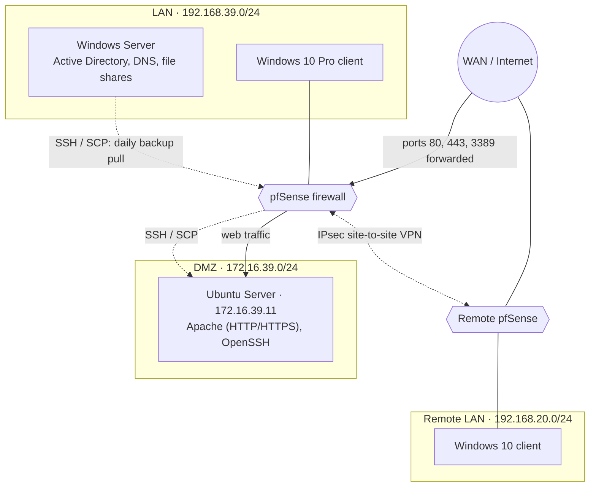

# Secure company network lab

Individual lab project for the network administration and security course at EPFC (Brussels), 2025–2026.

The goal was to design and deploy a small secured company network:

- a **pfSense firewall** separating three networks: the internal LAN, a DMZ and the WAN;
- a **Windows Server** with Active Directory and DNS to manage the internal network;
- an **Ubuntu web server** (Apache, HTTPS) in the DMZ, reachable from outside;
- **automated backups** of the website, retrieved by the internal server;
- a **site-to-site IPsec VPN** linking the LAN to a remote site.

Everything ran in virtual machines. The IP addresses below are those of the isolated lab environment.

## Network

## Firewall rules (pfSense)

The security policy: **nothing may enter the LAN**, the LAN may go anywhere, the DMZ may go out but never into the LAN, and only the published services are reachable from the WAN.

| Interface | Rule | Purpose |
|---|---|---|
| LAN | Allow LAN net → any | Internal machines can reach the DMZ and the Internet |
| DMZ | 1. **Block** DMZ net → LAN net | A compromised web server cannot reach the internal network |
| DMZ | 2. Allow DMZ net → any | The web server can reach the Internet |
| WAN | NAT port forward 80 and 443 → web server | Publish the website over HTTP and HTTPS |
| WAN | NAT port forward 3389 → Windows 10 client | Remote Desktop to the internal client (lab requirement) |
| IPsec | Allow IPsec traffic | Traffic between the two LANs through the tunnel |

pfSense evaluates rules from top to bottom and stops at the first match, so the order of the two DMZ rules matters. My first attempt was a single rule "DMZ net → WAN net", which did not work: Internet addresses are not part of the WAN subnet. The fix was to allow "DMZ net → any" and to place a block rule "DMZ net → LAN net" above it.

## What was set up

**pfSense.** LAN interface moved to 192.168.39.1/24 with DHCP, DMZ interface added at 172.16.39.1/24, rules and port forwards above, managed through the web interface from the LAN.

**Web server (DMZ).** Ubuntu Server with a static address, Apache installed with `apt` and managed with `systemctl`, OpenSSH. HTTPS with a self-signed X.509 certificate generated with OpenSSL, enabled with `a2enmod ssl` and `a2ensite default-ssl`.

**Active Directory (LAN).** New forest and domain `labo.lan`, client joined to the domain, organizational units for computers and users, Group Policies (logon message, no access to Control Panel), shared folders with NTFS permissions by group (students and teachers, full control on their own folder and read-only on the other one), and a logon script deployed by GPO that maps the share as a network drive.

**DNS.** Forwarder to 8.8.8.8 for external names, an A record `www.labo.lan` pointing to the web server, and a reverse lookup zone (`39.16.172.in-addr.arpa`) with a PTR record, tested with `nslookup`.

**Site-to-site VPN.** IPsec tunnel between the two pfSense firewalls. Phase 1 (IKE) authenticates both sides with a pre-shared key and uses Diffie-Hellman to agree on a shared secret; phase 2 defines the encryption and the two subnets (192.168.39.0/24 and 192.168.20.0/24). Tested with a ping between the two LANs.

**Backups.** Described below; the scripts are in the [`backup/`](backup/) folder.

## Backups

Because the DMZ may not open connections to the LAN, the web server cannot push its backups to the internal server. Instead, the Windows server **pulls** them.

| When | Where | What |
|---|---|---|
| Monday 23:00 | Ubuntu (cron) | `backup.sh full`: full backup of `/var/www/html` |
| Tuesday to Sunday 23:00 | Ubuntu (cron) | `backup.sh`: incremental backup (only changed files) |
| Every day 23:10 | Windows Server (Task Scheduler) | `fetch-latest-backup.ps1`: copies the latest backup over SCP |

- `tar --listed-incremental` keeps a snapshot file (`.snar`) with the state of the source at the last backup, so the next run only archives what changed. Deleting it forces a full backup.
- After each run the script checks tar's exit code and writes the success or failure to `backup_log.txt`.
- A symbolic link `latest` points to the last successful backup, so the Windows server can find it with `readlink -f`.
- SSH uses key authentication (`ssh-keygen`, public key in `authorized_keys`), so the transfer runs without a password.

### Why tar and not rsync

rsync with hard links gives a browsable copy of each backup without duplicating unchanged files. But once the backups are copied to Windows, the hard links become separate files, and every unchanged file would be stored again. tar produces one compressed archive per run containing only the changes, which is easy to transfer and takes no more space than needed. The trade-off: an incremental archive is useless without the previous ones, so losing one breaks the chain until the next full backup.

### Changes since the lab

While preparing this repository I reviewed the backup script and fixed three issues:

1. **`latest` was updated even when tar failed**, so the Windows server could fetch a broken archive while the log said "not successful". The link is now only updated after a successful backup, and the incomplete archive is deleted.
2. **Unquoted variables**: paths are now quoted, so a path with a space no longer breaks the script.
3. **Same-day overwrite**: the archive name now includes the time, so two runs on the same day do not overwrite each other.

The script also now exits with tar's exit code, so cron or a monitoring tool can detect a failed backup, and the PowerShell script stops with an error if it cannot find the latest backup.

## What I would do differently in production

- Not forward Remote Desktop from the WAN to an internal machine: remote users should connect through the VPN instead.
- Use a certificate from a real certificate authority instead of a self-signed one.

## Files

- [`backup/backup.sh`](backup/backup.sh): backup script (Ubuntu web server)
- [`backup/crontab.txt`](backup/crontab.txt): cron schedule
- [`backup/fetch-latest-backup.ps1`](backup/fetch-latest-backup.ps1): retrieval script (Windows Server)
